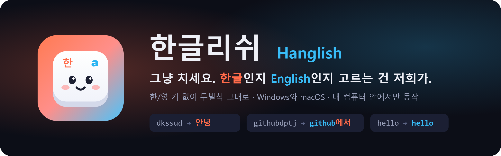
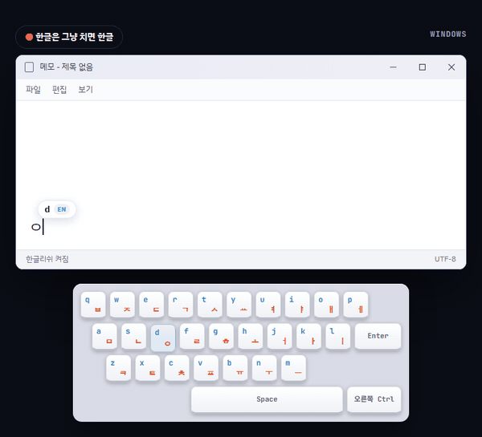
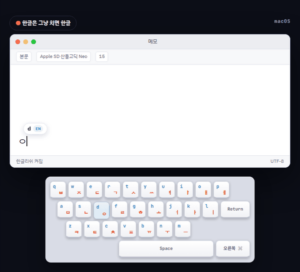
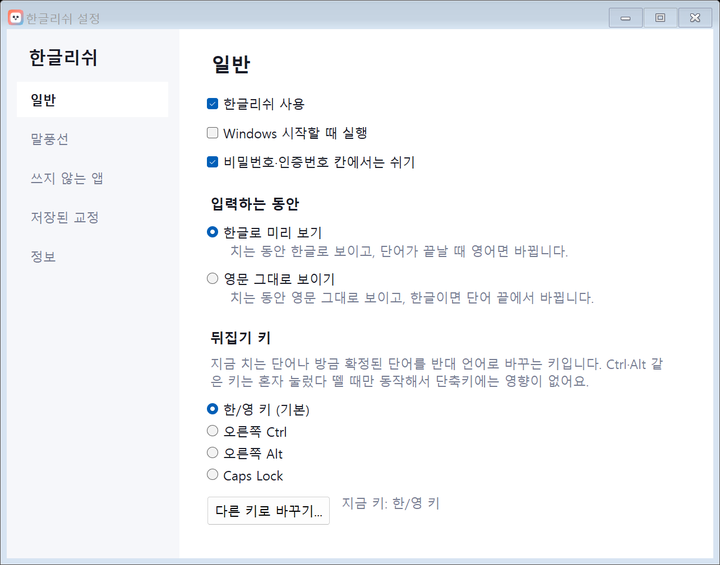
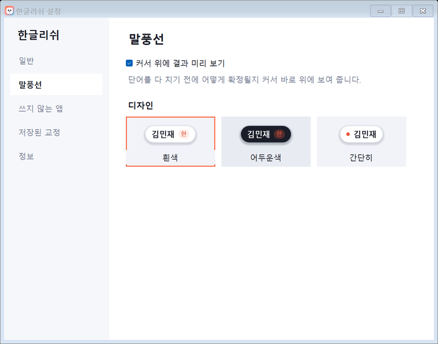

<p align="center">
  
</p>

<p align="center">
  <a href="../../releases/latest"></a>
  <a href="../../releases"></a>
  
  
  <a href="LICENSE"></a>
</p>

<p align="center">
  <a href="../../releases/latest/download/Hanglish-Setup.exe"></a>
  &nbsp;
  <a href="../../releases/latest/download/Hanglish.dmg"></a>
</p>

<p align="center">
  <a href="https://mingjaam.github.io/hanglish/"><b>웹사이트</b></a> &nbsp;·&nbsp;
  <a href="#설치">설치</a> &nbsp;·&nbsp;
  <a href="#이런-걸-해요">기능</a> &nbsp;·&nbsp;
  <a href="#정확도">정확도</a> &nbsp;·&nbsp;
  <a href="#자주-묻는-질문">FAQ</a>
  <br>
  <sub>설치 없이 쓰고 싶다면 <a href="../../releases/latest/download/Hanglish-windows-x64.zip">Windows 압축 파일</a> · <a href="../../releases/latest/download/Hanglish-macos.zip">macOS 압축 파일</a></sub>
</p>

<br>

<table>
  <tr>
    <th width="50%">Windows</th>
    <th width="50%">macOS</th>
  </tr>
  <tr>
    <td></td>
    <td></td>
  </tr>
</table>

<p align="center"><sub>실제 판단 엔진이 키마다 보여 준 결과를 그대로 재생한 화면입니다.</sub></p>

## 이런 걸 해요

영문 자판 그대로 두벌식 자리를 치면, **띄어쓰기·엔터·문장부호를 누르는 순간** 그 단어를 한글로 쓸지 영어로 쓸지 골라 줍니다.

| 이렇게 치면 | 이렇게 써져요 | |
|:---|:---|:---|
| `dkssudgktpdy` | **안녕하세요** | 한글은 그냥 한글 |
| `hello world` | **hello world** | 영어도 언어를 바꾸지 않고 그대로 |
| `githubdptj` | **github에서** | 영어 단어 + 한글 조사를 알아서 나눠요 |
| `rlaalswo` | **김민재** | 사전에 없는 이름도 한글로 |
| `so good` | **so good** | 처음엔 "내"로 보여도 뒤 단어를 보고 고쳐요 |
| `dlTEk` | **있다** | ㅆ 다음 글자까지 Shift가 눌린 실수도 문맥으로 |

<table>
  <tr>
    <td width="33%" valign="top">
      <h3>틀리면 키 하나</h3>
      Windows는 <kbd>한/영</kbd>, macOS는 <kbd>Caps Lock</kbd>을 한 번. 방금 단어가 반대 언어로 바뀌고, 같은 앞 단어 뒤에서 기억해요. 키는 설정에서 원하는 대로 바꿀 수 있어요.
    </td>
    <td width="33%" valign="top">
      <h3>커서 위 미리보기</h3>
      단어를 다 치기 전에 어떻게 확정될지 커서 바로 위에 작은 말풍선으로 보여 줘요. 흰색 · 어두운색 · 간단히 중에서 고를 수 있어요.
    </td>
    <td width="33%" valign="top">
      <h3>내 컴퓨터 안에서만</h3>
      판단은 PC 안의 작은 사전과 확률 모델이 해요. 입력 내용을 보내거나 저장하지 않고, 비밀번호·인증번호 칸에서는 쉬어요.
    </td>
  </tr>
  <tr>
    <td width="33%" valign="top">
      <h3>앞 단어도 다시 봐요</h3>
      <code>so</code>처럼 양쪽 다 말이 되는 짧은 단어는 일단 확정해 두고, 다음 단어로 언어가 분명해지면 함께 고쳐요.
    </td>
    <td width="33%" valign="top">
      <h3>설정 창</h3>
      말풍선 디자인, 뒤집기 키, 쓰지 않을 앱, 기억한 교정을 한곳에서 바꿔요.
    </td>
    <td width="33%" valign="top">
      <h3>설치 파일 하나로</h3>
      Windows는 설치 프로그램, macOS는 디스크 이미지. 인터넷 연결도, 따로 깔 프로그램도 필요 없어요.
    </td>
  </tr>
</table>

<p align="center">
  
  
</p>

## 설치

<table>
  <tr>
    <th width="50%">Windows 10 · 11</th>
    <th width="50%">macOS 13 이상 (Apple 실리콘 · Intel)</th>
  </tr>
  <tr>
    <td valign="top">
      <ol>
        <li><a href="../../releases/latest/download/Hanglish-Setup.exe"><b>Hanglish-Setup.exe</b></a>를 받아 실행해요.<br><sub>"Windows의 PC 보호" 창이 뜨면 <b>추가 정보 → 실행</b>. 서명 인증서가 없는 무료 프로그램이라 뜨는 창이에요.</sub></li>
        <li>설치는 관리자 권한 없이 끝나요.<br><sub>바탕 화면 바로가기, Windows 시작 시 자동 실행은 체크로 골라요.</sub></li>
        <li>시작 메뉴에 <b>한글리쉬</b>가 생겨요.<br><sub>켜져 있을 때 다시 누르면 설정 창이 열려요. 제거는 "앱 및 기능"에서.</sub></li>
      </ol>
    </td>
    <td valign="top">
      <ol>
        <li><a href="../../releases/latest/download/Hanglish.dmg"><b>Hanglish.dmg</b></a>를 열고, 한글리쉬 아이콘을 <b>응용 프로그램</b> 폴더로 끌어다 놓아요.</li>
        <li>처음 열 때 안내가 나오면 <b>시스템 설정 → 개인정보 보호 및 보안 → 그래도 열기</b>.</li>
        <li><b>손쉬운 사용</b>에서 한글리쉬를 켜요. <sub>(키 입력을 받는 데 필요해요)</sub></li>
        <li>입력 소스는 ABC로 두고 그냥 치세요.<br><sub>Launchpad에서 한글리쉬를 다시 열면 설정 창이 열려요.</sub></li>
      </ol>
    </td>
  </tr>
</table>

### 기본 키

| | Windows | macOS |
|:---|:---|:---|
| 방금 단어를 반대 언어로 바꾸기 | <kbd>한/영</kbd> | <kbd>Caps Lock</kbd> |
| 치던 단어를 영문 그대로 확정 | <kbd>Esc</kbd> | <kbd>esc</kbd> |
| 설정 열기 | 트레이 아이콘 두 번 클릭, 또는 시작 메뉴에서 다시 실행 | 메뉴 막대 아이콘, 또는 Launchpad에서 다시 열기 |

뒤집기 키는 설정 → 일반 → 뒤집기 키에서 목록에서 고르거나 **다른 키로 바꾸기**로 원하는 키를 눌러 지정할 수 있어요. <kbd>Ctrl</kbd> · <kbd>⌘</kbd> 같은 키를 고르면 혼자 눌렀다 뗄 때만 동작해서 단축키에는 영향이 없어요.

## 정확도

학습에 쓰지 않은 문장을 두벌식 키로 바꿔 끝까지 쳐 본 뒤, **문장 전체가 그대로 나온 비율**이에요.

| 시험 데이터 | 개수 | 정확도 |
|:---|---:|---:|
| 한국어 문장 (Tatoeba) | 3,000 | **100%** |
| 영어 문장 (Tatoeba) | 3,000 | **100%** |
| 영어 단어 + 조사가 섞인 문장\* | 800 | **99.1%** |
| 사람 이름\* | 800 | **99.1%** |
| Shift가 한 글자 더 눌린 문장\* | 600 | **100%** |
| 문맥 없는 영어 단어 하나 | 800 | **99.8%** |

<sub>\* 자동으로 만든 시험용 데이터예요. 문맥 없이 <code>go</code>만 치면 "해"가 되는 것처럼, 양쪽 다 흔한 짧은 단어 하나는 틀릴 수 있어요. 그럴 땐 뒤집기 키 한 번이면 돼요.</sub>

## 어떻게 고르나요

```text
 dkssud  ──▶  여러 가지로 읽기  ──▶  점수 매기기  ──▶  확정
              · dkssud (영어)         · 단어 빈도 사전            · 가장 그럴듯한 쪽으로
              · 안녕 (두벌식 한글)    · 키 순서 확률 모델         · 애매하면 다음 단어를
              · 영어 + 조사           · 앞 문장의 한글 비율         보고 함께 고쳐요
              · Shift 실수를 뺀 한글
```

- 단어 빈도 사전(영어 11만 · 한국어 17만 단어)과 키 순서 5-gram 모델을 섞어 확률을 계산해요.
- Windows는 키보드 후킹으로, macOS는 CGEvent 탭으로 키를 받아 글자를 바꿔 써요.
- 판단 엔진은 C#과 Swift로 같은 내용을 구현했고, macOS 테스트가 두 엔진의 결과가 같은지 매번 확인해요 (현재 1,524문장 모두 일치).

## 자주 묻는 질문

<details>
<summary><b>입력한 내용이 어디로 가나요?</b></summary>
<br>
아무 데도 가지 않아요. 판단은 컴퓨터 안에서만 하고 인터넷 연결도 쓰지 않아요. 저장하는 건 직접 고친 단어 목록과 설정뿐이에요.
</details>

<details>
<summary><b>비밀번호나 인증번호를 칠 때는요?</b></summary>
<br>
비밀번호 칸과 "인증번호", "OTP", "Verification code" 같은 이름이 붙은 칸에서는 쉬어요. 브라우저의 비밀번호 칸도 알아봐요. 설정 → 일반에서 끌 수 있어요.
</details>

<details>
<summary><b>한/영 키를 습관처럼 눌러도 되나요?</b></summary>
<br>
Windows에서는 한/영 키가 뒤집기 키라서, 방금 친 단어가 반대 언어로 바뀌어요. 습관 때문에 불편하면 설정에서 뒤집기 키를 오른쪽 Ctrl 같은 다른 키로 바꿔 주세요. 그러면 한/영 키는 아무 일도 하지 않아요. 잘못 기억된 교정은 설정 → 저장된 교정에서 지울 수 있어요.
</details>

<details>
<summary><b>게임이나 vim처럼 글자 키를 단축키로 쓰는 프로그램은요?</b></summary>
<br>
메뉴의 "○○에서는 쓰지 않기"나 설정 창의 "쓰지 않는 앱"에 넣으면 그 프로그램에서만 꺼져요.
</details>

<details>
<summary><b>잘 안 되는 곳이 있나요?</b></summary>
<br>

- 진짜 입력기(IME)가 아니라 키를 받아 지우고 다시 쓰는 방식이라, 자동완성이 글자를 선택해 두는 입력창(브라우저 주소창 등)에서는 어긋날 수 있어요.
- Windows에서 관리자 권한으로 실행된 창에는 글자를 보낼 수 없어요.
- macOS 앱은 Apple 개발자 서명이 없어서, 업데이트할 때마다 손쉬운 사용 권한을 다시 켜야 할 수 있어요.
</details>

<details>
<summary><b>백신이 막아요.</b></summary>
<br>
키 입력을 받아 글자를 바꿔 쓰기 때문에 일부 백신이 의심할 수 있어요. 소스 코드가 모두 공개되어 있으니 확인한 뒤 예외로 등록해 주세요.
</details>

## 개발

<details>
<summary><b>직접 빌드하기</b></summary>
<br>

```sh
# Windows (.NET 9 SDK, Inno Setup 6.4 이상)
dotnet run --project src/Hanglish.Eval -c Release -- --engine          # 상태 처리 테스트
dotnet run --project src/Hanglish.Eval -c Release -- --corpus tests/corpus/ko_test.txt tests/corpus/mixed_test.txt
dotnet publish src/Hanglish/Hanglish.csproj -c Release -r win-x64 --self-contained true -o out/Hanglish
ISCC /DVersion=0.3.0 /DSource=%CD%\out\Hanglish installer\Hanglish.iss   # out\Hanglish-Setup.exe

# macOS (Xcode 15 이상)
sh mac/scripts/prepare.sh            # 사전을 Swift 패키지로 복사
(cd mac && swift test)               # Windows 엔진과 결과 비교 포함
sh mac/scripts/bundle.sh 0.3.0 "$PWD/out"   # Hanglish.dmg + zip
```

`v*` 태그를 올리면 GitHub Actions가 Windows 설치 프로그램, macOS 디스크 이미지, 압축 파일을 만들어 Release에 올려요. `site/`는 main에 올릴 때 GitHub Pages로 배포돼요.
</details>

<details>
<summary><b>폴더 구성</b></summary>
<br>

| 경로 | 내용 |
|:---|:---|
| `src/Hanglish.Core` | 판단 엔진 (C#) |
| `src/Hanglish` | Windows 앱 — 트레이, 키보드 후킹, 말풍선, 설정 창 |
| `src/Hanglish.Eval` | 테스트, 정확도 측정, 파라미터 튜닝, 사이트 데모 기록 |
| `mac/` | macOS 앱과 Swift 판단 엔진 |
| `installer/` | Windows 설치 프로그램 스크립트 (Inno Setup) |
| `site/` | 설치 사이트 (GitHub Pages) |
| `tools/` | 사전 · 시험 데이터 · 아이콘 · GIF 만드는 스크립트 |
| `tests/` | 시험 문장과 실제 입력 테스트 도구 |
</details>

## 라이선스와 데이터 출처

- 코드: [MIT License](LICENSE)
- 단어 빈도 사전: [FrequencyWords](https://github.com/hermitdave/FrequencyWords) (OpenSubtitles 2018), [wordfreq](https://github.com/rspeer/wordfreq) — CC BY-SA 4.0
- 시험 문장: [Tatoeba](https://tatoeba.org) — CC BY 2.0 FR (테스트에만 쓰고 앱에는 들어가지 않아요)

<p align="center"><br></p>
