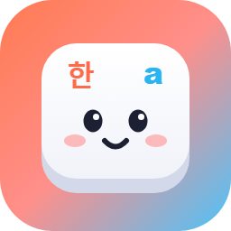

<p align="center">
  
</p>

<h1 align="center">한글리쉬 Hanglish</h1>

<p align="center">
  <b>그냥 치세요. 한글인지 English인지 고르는 건 한글리쉬가.</b><br>
  한/영 키 없이 영문 자판 그대로 두벌식 자리를 치면, 단어가 끝나는 순간 한글로 쓸지 영어로 쓸지 골라 주는 Windows · macOS 도우미입니다.
</p>

<p align="center">
  <a href="../../releases/latest/download/Hanglish-windows-x64.zip"><b>⬇ Windows용 받기</b></a>
  &nbsp;·&nbsp;
  <a href="../../releases/latest/download/Hanglish-macos.zip"><b>⬇ macOS용 받기</b></a>
  &nbsp;·&nbsp;
  <a href="https://mingjaam.github.io/hanglish/">웹사이트</a>
</p>

| Windows | macOS |
|:---:|:---:|
|  |  |

<sub>위 화면은 실제 판단 엔진이 키마다 보여 준 결과를 그대로 재생한 것입니다.</sub>

## 무엇을 하나요

| 이렇게 치면 | 이렇게 써져요 | |
|---|---|---|
| `dkssudgktpdy` | 안녕하세요 | 한글은 그냥 한글 |
| `hello world` | hello world | 영어도 한/영 키 없이 |
| `githubdptj` | github에서 | 영어 단어 + 한글 조사 |
| `rlaalswo` | 김민재 | 사전에 없는 이름도 한글로 |
| `so good` | so good | 처음엔 "내"로 보여도 뒤 단어를 보고 고침 |
| `dlTEk` | 있다 | ㅆ 다음 글자까지 Shift가 눌린 실수도 문맥으로 |

- **커서 위 미리보기** — 단어를 다 치기 전에 어떻게 확정될지 커서 위에 작은 말풍선으로 보여 줍니다. 흰색 · 어두운색 · 간단히 중에 고를 수 있어요.
- **틀리면 키 하나** — Windows는 오른쪽 <kbd>Ctrl</kbd>, macOS는 오른쪽 <kbd>⌘</kbd>을 한 번 누르면 방금 단어가 반대 언어로 바뀝니다. 바꾼 결과는 같은 앞 단어 뒤에서 기억하고, 서로 다른 두 곳에서 같은 교정을 하면 어디서나 적용합니다.
- **한/영 키는 쉬어요** — 한/영 키를 눌러도 아무 일도 하지 않습니다. 습관처럼 눌러도 괜찮아요.
- **내 컴퓨터 안에서만** — 판단은 PC 안의 단어 빈도 사전과 키 순서 확률 모델이 합니다. 입력 내용을 보내거나 저장하지 않습니다.

## 설치

### Windows 10 · 11

1. [Hanglish-windows-x64.zip](../../releases/latest/download/Hanglish-windows-x64.zip)을 받아 압축을 풉니다.
2. `Hanglish.exe`를 실행합니다. "Windows의 PC 보호" 창이 뜨면 **추가 정보 → 실행**을 누르세요(서명 인증서가 없는 무료 프로그램이라 뜨는 창입니다).
3. 작업 표시줄 트레이에 아이콘이 생기면 끝. 아이콘을 두 번 누르면 설정 창이 열립니다.

### macOS 13 이상 (Apple 실리콘 · Intel)

1. [Hanglish-macos.zip](../../releases/latest/download/Hanglish-macos.zip)을 받아 압축을 풀고 `Hanglish.app`을 응용 프로그램 폴더로 옮깁니다.
2. 처음 열 때 안내가 나오면 **시스템 설정 → 개인정보 보호 및 보안 → 그래도 열기**를 누릅니다.
3. **시스템 설정 → 개인정보 보호 및 보안 → 손쉬운 사용**에서 한글리쉬를 켭니다(키 입력을 받는 데 필요합니다).
4. 입력 소스는 ABC로 두고 그냥 치세요. 메뉴 막대 아이콘 → **설정 열기**에서 원하는 대로 바꿀 수 있습니다.

## 설정

 

- **일반** — 켜기/끄기, 시작할 때 실행, 입력 중 표시(한글로 미리 보기 / 영문 그대로), 뒤집기 키
- **말풍선** — 커서 위 미리보기 켜기/끄기, 디자인(흰색 · 어두운색 · 간단히)
- **쓰지 않는 앱** — 게임이나 vim처럼 글자 키를 단축키로 쓰는 프로그램에서 끄기
- **저장된 교정** — 기억한 교정을 보고 하나씩 또는 모두 지우기

## 정확도

학습에 쓰지 않은 문장을 두벌식 키로 바꿔 끝까지 쳐 본 뒤, 문장 전체가 그대로 나온 비율입니다(2026-10-21).

| 시험 데이터 | 개수 | 문장 정확도 |
|---|---:|---:|
| 한국어 문장 (Tatoeba) | 3,000 | 100% |
| 영어 문장 (Tatoeba) | 3,000 | 100% |
| 영어 단어 + 조사가 섞인 문장\* | 800 | 99.1% |
| 사람 이름\* | 800 | 99.1% |
| Shift가 한 글자 더 눌린 문장\* | 600 | 100% |
| 문맥 없는 영어 단어 하나 | 800 | 99.8% |

\* 자동으로 만든 시험용 데이터입니다. 문맥 없이 `go`만 치면 "해"가 되는 것처럼, 양쪽 다 흔한 짧은 단어 하나는 틀릴 수 있습니다. 그럴 땐 뒤집기 키 한 번이면 됩니다.

## 동작 원리

1. 영문 자판에서 친 키(`dkssud`)를 단어가 끝날 때까지 모읍니다.
2. 같은 키를 여러 가지로 읽습니다: 영어 그대로, 두벌식 한글(안녕), 영어 + 조사(github에서), Shift 실수를 뺀 한글.
3. 각 읽기의 점수를 매깁니다: 단어 빈도 사전(영어 11만 · 한국어 17만 단어)과 키 순서 5-gram 모델을 섞은 확률, 앞 문장에서 한글이 차지하는 비율.
4. 가장 그럴듯한 쪽으로 바꿔 씁니다. 양쪽 다 흔한 단어는 일단 확정해 두고, 다음 단어로 언어가 분명해지면 함께 고칩니다.

Windows는 저수준 키보드 후킹으로, macOS는 CGEvent 탭으로 키를 받아 글자를 바꿔 씁니다. 판단 엔진은 C#(`src/Hanglish.Core`)과 Swift(`mac/Sources/HanglishCore`)로 같은 내용을 구현했고, macOS 테스트가 두 엔진의 결과가 같은지 확인합니다.

## 알려진 한계

- 진짜 입력기(IME)가 아니라 키를 받아 지우고 다시 쓰는 방식이라, 자동완성이 글자를 선택해 두는 입력창(브라우저 주소창 등)에서는 어긋날 수 있습니다.
- Windows에서 관리자 권한으로 실행된 창에는 글자를 보낼 수 없습니다.
- Windows에서 웹 브라우저의 비밀번호 칸은 알아채지 못합니다. 비밀번호를 칠 때는 잠시 꺼 주세요. (macOS는 보안 입력 중에 자동으로 멈춥니다.)
- macOS 앱은 Apple 개발자 서명이 없어서, 업데이트할 때마다 손쉬운 사용 권한을 다시 켜야 할 수 있습니다.

## 직접 빌드하기

```sh
# Windows (.NET 9 SDK)
dotnet run --project src/Hanglish.Eval -c Release -- --engine                 # 상태 처리 테스트
dotnet run --project src/Hanglish.Eval -c Release -- --corpus tests/corpus/ko_test.txt tests/corpus/mixed_test.txt
dotnet publish src/Hanglish/Hanglish.csproj -c Release -r win-x64 --self-contained true -p:PublishSingleFile=true -o out

# macOS (Xcode 15 이상)
sh mac/scripts/prepare.sh            # 사전을 Swift 패키지로 복사
(cd mac && swift test)               # Windows 엔진과 결과 비교 포함
sh mac/scripts/bundle.sh 0.2.0 "$PWD/out"
```

`v*` 태그를 올리면 GitHub Actions가 두 운영체제용 zip을 만들어 Release에 올리고, `site/`를 GitHub Pages로 배포합니다.

| 도구 | 하는 일 |
|---|---|
| `tools/build_lexicon.py` | 단어 빈도 사전 `lexicon.tsv.gz` 만들기 |
| `tools/build_corpus.py`, `tools/build_hard_corpus.py` | 시험용 문장 만들기 |
| `tools/make_icons.py` | `assets/*.svg`에서 아이콘(.ico, .iconset, 메뉴 막대) 만들기 |
| `tools/make_readme_gif.py` | 웹사이트 데모를 README용 GIF로 만들기 |

## 라이선스와 데이터 출처

- 코드: [MIT License](LICENSE)
- 단어 빈도 사전: [FrequencyWords](https://github.com/hermitdave/FrequencyWords)(OpenSubtitles 2018), [wordfreq](https://github.com/rspeer/wordfreq) — CC BY-SA 4.0
- 시험 문장: [Tatoeba](https://tatoeba.org) — CC BY 2.0 FR (테스트에만 쓰고 앱에는 들어가지 않습니다)
